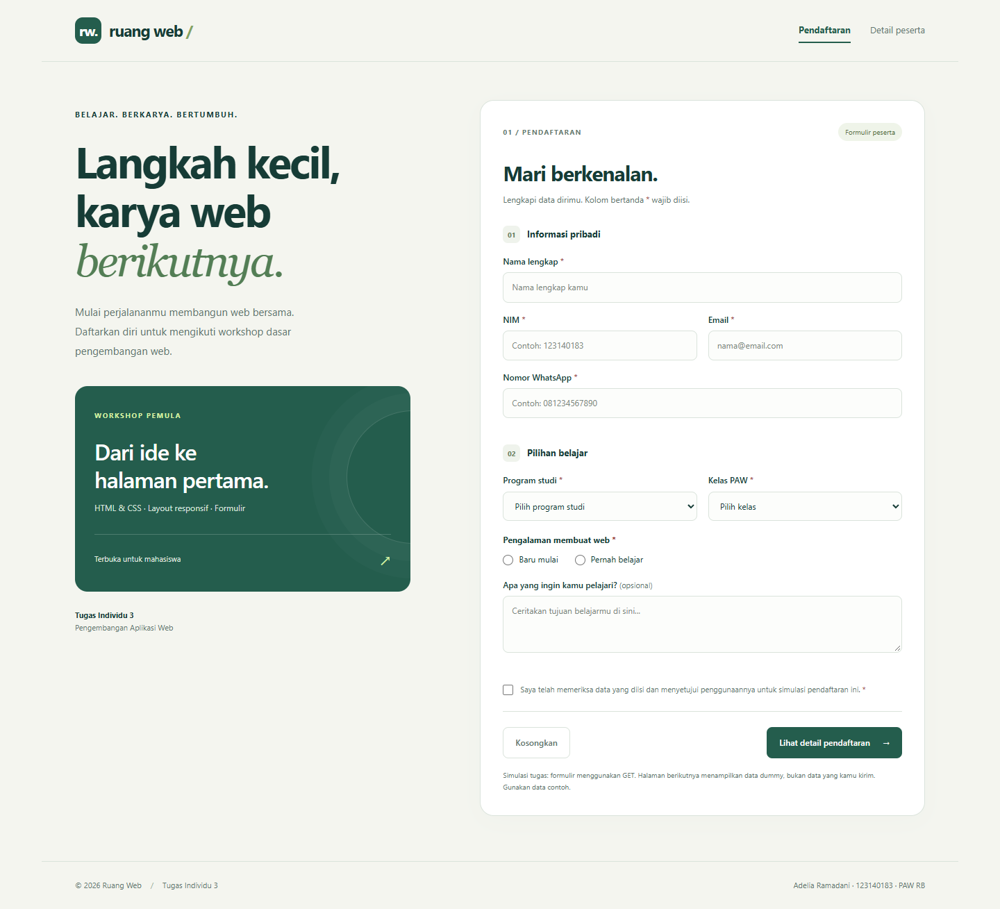
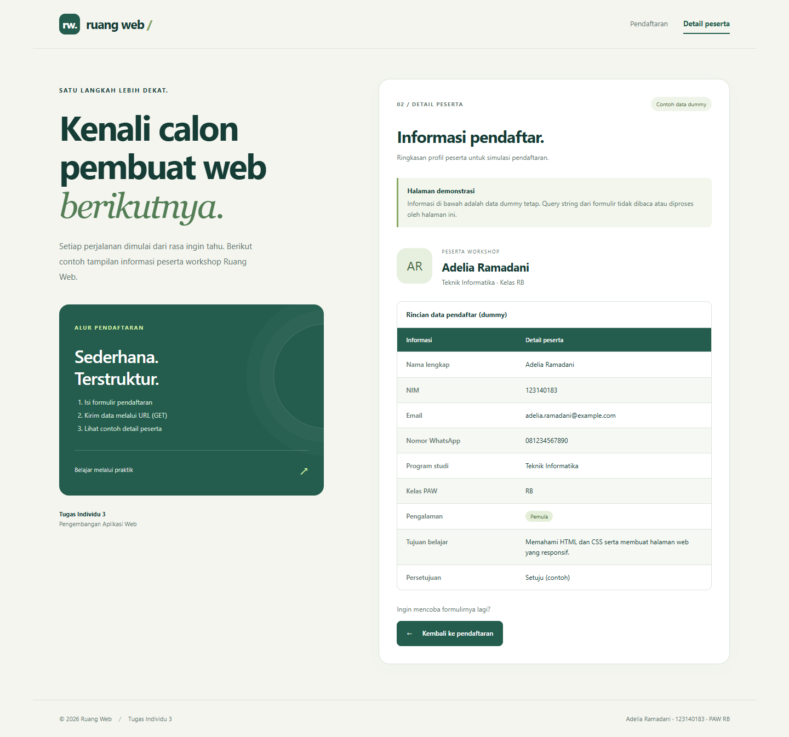
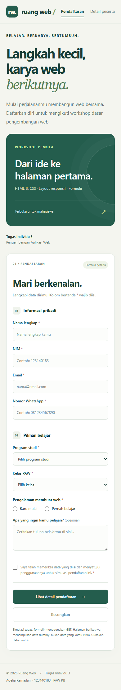

# Tugas Individu 3 — Pengembangan Aplikasi Web

| Identitas | Keterangan |
| --- | --- |
| Nama | Adelia Ramadani |
| NIM | 123140183 |
| Kelas | PAW RB |

## Deskripsi

**Ruang Web** adalah website sederhana bertema pendaftaran workshop dasar pengembangan web. Website dibuat menggunakan HTML5 dan CSS3 tanpa framework, JavaScript, database, maupun backend. Kode tugas ditempatkan dalam folder `task_3`.

## Cara menjalankan

1. Clone atau unduh repository ini.
2. Buka `task_3/index.html` melalui browser, atau gunakan ekstensi Live Server di VS Code.
3. Isi formulir dengan **data contoh**, lalu klik **Lihat detail pendaftaran**.
4. Browser membuka `detail.html` dengan query string pada URL. Halaman detail tetap menampilkan data dummy.

## Struktur file

```text
.
├── README.md
└── task_3/
    ├── index.html
    ├── detail.html
    ├── style.css
    ├── screenshots/
    │   ├── pendaftaran-desktop.png
    │   ├── detail-desktop.png
    │   └── pendaftaran-mobile.png
    └── RB-Adelia Ramadani-123140183-Tugas3-Pemweb.pdf
```

## Penjelasan implementasi

### 1. Halaman pendaftaran (`index.html`)

Halaman ini berisi formulir dengan nama lengkap, NIM, email, nomor WhatsApp, program studi, kelas PAW, pengalaman membuat web, tujuan belajar, dan persetujuan. Form control yang digunakan meliputi input teks, email, telepon, select, radio, textarea, checkbox, serta tombol submit dan reset. Setiap kontrol memiliki label.

Validasi bawaan HTML menggunakan `required`, `type="email"`, dan `pattern`. NIM harus terdiri dari 9 angka. Nomor telepon terdiri dari 10–15 angka dan boleh diawali tanda `+`. Kolom tujuan belajar bersifat opsional. Tombol **Kosongkan** mengembalikan formulir ke keadaan awal.

```html
<form action="detail.html" method="get">
```

Atribut `action` menentukan halaman tujuan, sedangkan `method="get"` membuat browser memasukkan data formulir ke query string. Atribut `name` pada kontrol menjadi nama parameter URL. Radio mengirim pilihan yang dipilih; checkbox mengirim nilai `setuju` setelah dicentang.

### 2. Desain query string

Contoh URL hasil pengiriman data contoh:

```text
detail.html?nama=Adelia+Ramadani&nim=123140183&email=adelia.ramadani%40example.com&telepon=081234567890&program_studi=Teknik+Informatika&kelas=RB&pengalaman=Pemula&motivasi=Belajar+HTML+dan+CSS&persetujuan=setuju
```

Tanda `?` mengawali query string, `&` memisahkan parameter, dan `=` memisahkan nama parameter dengan nilainya. Browser melakukan encoding secara otomatis: spasi menjadi `+` dan karakter `@` menjadi `%40`.

**Sesuai ketentuan tugas, query string hanya dirancang dan dikirim. Halaman detail tidak menangkap, membaca, menyimpan, atau memproses parameter tersebut.** Oleh karena nilai formulir terlihat di URL, gunakan data contoh dan jangan masukkan data sensitif.

### 3. Halaman detail (`detail.html`)

Halaman kedua berisi pemberitahuan simulasi, profil contoh peserta, dan tabel informasi pendaftar. Semua data ditulis langsung dalam HTML sebagai **data dummy tetap**, termasuk email `adelia.ramadani@example.com` dan nomor telepon contoh. Mengubah data formulir atau query string tidak mengubah isi tabel. Tombol kembali mengarah ke halaman pendaftaran.

Tabel menggunakan `caption`, `thead`, `tbody`, serta `th scope="col"` dan `th scope="row"` untuk memperjelas hubungan header dan data. Warna selang-seling dan efek hover membantu keterbacaan. Profil contoh juga diberi microformats `h-card`, `p-name`, dan `p-org` sebagai penerapan tambahan materi pertemuan.

### 4. CSS, layout, dan responsivitas (`style.css`)

CSS eksternal digunakan bersama oleh kedua halaman. Tema hijau dengan latar krem membedakan area pengantar, kotak workshop, formulir, dan tabel.

| Jenis selector | Contoh | Fungsi |
| --- | --- | --- |
| Elemen | `body`, `table`, `fieldset` | Mengatur tampilan dasar elemen |
| Class | `.panel`, `.workshop-card`, `.form-grid` | Mengatur kotak dan layout komponen |
| ID | `#main-content` | Membatasi lebar area utama |
| Atribut | `input[type="radio"]` | Mengatur kontrol tertentu |
| Atribut | `nav a[aria-current="page"]` | Menandai navigasi halaman aktif |
| Turunan | `.field > label` | Mengatur label pada setiap field |
| Pseudo-class | `tbody tr:nth-child(even)`, `:hover`, `:focus-visible` | Zebra stripes, interaksi, dan fokus keyboard |
| Pseudo-element | `.workshop-card::after` | Membuat dekorasi kotak workshop |

Grid dipakai untuk layout dua kolom dan pasangan input. Flexbox dipakai pada header, navigasi, profil, tombol, dan footer. Media query pada lebar 1000, 720, dan 430 piksel menyesuaikan tata letak: kolom utama bertumpuk pada ponsel, input menjadi satu kolom pada layar sempit, dan tombol tetap mudah dijangkau. Tabel dibungkus kontainer `overflow-x: auto`.

## Kesesuaian dengan tugas

| Ketentuan Tugas Individu 3 | Implementasi |
| --- | --- |
| Dua halaman | `index.html` dan `detail.html` |
| Formulir menggunakan GET | `method="get" action="detail.html"` |
| Halaman detail dummy | Tabel statis tanpa pemrosesan query string |
| Desain query string | Atribut `name` dan contoh URL pada README |
| Minimal tiga selector | Elemen, class, ID, atribut, dan pseudo-class |
| Layout, box, tabel, dan form dengan CSS | Grid, Flexbox, panel, tabel, dan form control |
| Folder pengumpulan `task_3` | Semua kode dan laporan berada di `task_3` |
| Format nama laporan | `RB-Adelia Ramadani-123140183-Tugas3-Pemweb.pdf` |

## Tampilan

### Halaman pendaftaran



### Halaman detail



### Tampilan ponsel



## Pengujian

- Memeriksa validasi kolom wajib, format email, NIM, dan telepon.
- Mengirim formulir dan memeriksa halaman tujuan serta parameter GET.
- Mengirim data berbeda dan memastikan detail tetap berisi data dummy.
- Memeriksa tombol reset dan navigasi antardua halaman.
- Memeriksa tampilan desktop serta layar 390 dan 320 piksel agar tidak terjadi luapan horizontal.

## Referensi materi

Materi pertemuan 4: *Tabel, Formulir, Layout dan Web Media*, terutama ketentuan **Tugas Individu 3** pada halaman 51. Implementasi mempertahankan batasan halaman detail dummy dan tidak menambahkan pemrosesan data.
